# CivicEye — UML Diagrams

The nine UML diagrams required by the *UNIT III (Part-2)* presentation (use case, class, object, sequence, collaboration, state machine, activity, component, deployment), modelled against the CivicEye implementation in `src/civiceye/**`.

All nine use **StarUML notation**: white shapes, 1 px black borders, black Arial labels, stick-figure actors, underlined object rectangles, thick fork/join bars and 3-D nodes — no colour fills, no icons and no diagram-frame legends.

Each diagram is stored three times in [`uml/`](uml/): the PlantUML source (`NN_name.puml`), the rendered PNG (`NN_name.png`, 2×) and the vector SVG (`NN_name.svg`). Re-render them with `cd docs/uml && ./render.sh`.

> An earlier, text-only Mermaid rendering of the same nine diagrams is kept in [`uml/mermaid/`](uml/mermaid/) for reference; the PlantUML set is the canonical one because it uses proper UML notation.

---

## 1. Use Case Diagram

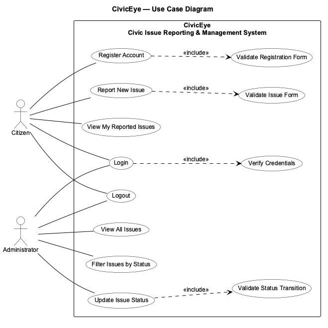

Shows the actors of CivicEye, the system boundary and the way the individual
use cases are related to each other.

- **Actors** — `Citizen` and `Administrator`, drawn as StarUML stick figures
  outside the system boundary. `Login` and `Logout` are shared by both.
- **System boundary** — the rectangle around the use cases is the Swing
  application `CivicEye`.
- **`«include»`** — behaviour that is always executed: *Register Account* →
  *Validate Registration Form*, *Report New Issue* → *Validate Issue Form*,
  *Login* → *Verify Credentials*, *Update Issue Status* → *Validate Status
  Transition*.
- Every association is a single straight line between the actor and the
  ellipse: the use cases are ordered so that the Citizen cases sit at the top
  and the Administrator cases at the bottom, which keeps the lines short and
  free of crossings.

PlantUML source — <code>uml/01_use_case.puml</code>

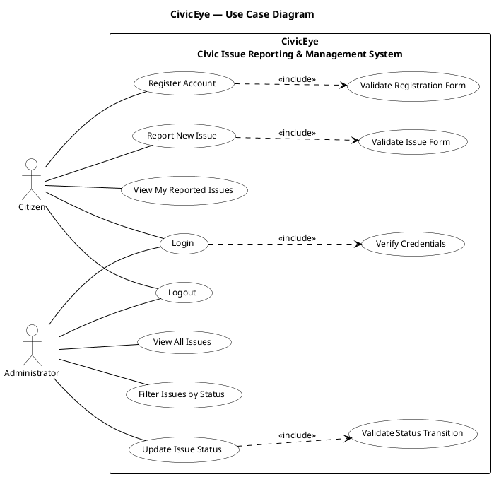

---

## 2. Class Diagram

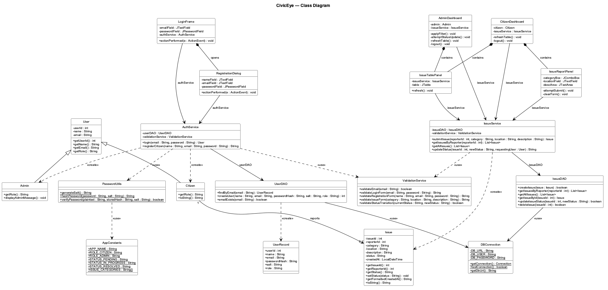

The static model of the application as plain class rectangles — no package
frames, exactly as StarUML draws a class diagram. The UI classes hold no SQL
and no business rules, the service classes hold the rules, and only the DAO
classes issue SQL.

- `User` is abstract; `Citizen` and `Admin` specialise it and override `getRole()`.
- `Issue` is a plain POJO (7 attributes, accessors plus `setIssueId()` and
  `setStatus()`).
- `IssueService.updateStatus()` takes the *requesting user* and rejects the call
  unless it is an `Admin`, so no view can bypass the rule.
- `AuthService` depends on `PasswordUtils` (SHA-256 + per-user salt) and on
  `ValidationService`; both DAOs obtain their connection from `DBConnection`.
- The UI classes are composed of the two panels (`IssueReportPanel`,
  `IssueTablePanel`) and both dashboards.

PlantUML source — <code>uml/02_class.puml</code>

```plantuml
@startuml civiceye_class
' ===================================================================
'  CivicEye — Civic Issue Reporting & Management System
'  Diagram 2 of 9 : CLASS DIAGRAM
'  Notation: StarUML 5 — plain class rectangles (no package frames),
'  white fill, black border, Arial, attribute / operation
'  compartments.  Classes of the same layer are kept together.
' ===================================================================
title CivicEye — Class Diagram

skinparam backgroundColor #FFFFFF
skinparam shadowing false
skinparam defaultFontName Arial
skinparam defaultFontSize 11
skinparam defaultFontColor #000000
skinparam ArrowColor #000000
skinparam ArrowFontColor #000000
skinparam ArrowFontName Arial
skinparam ArrowFontSize 10
skinparam BorderColor #000000
skinparam BorderThickness 1
skinparam classAttributeIconSize 0
skinparam nodesep 35
skinparam ranksep 55

skinparam class {
  BackgroundColor #FFFFFF
  BorderColor #000000
  FontColor #000000
  FontSize 11
  FontStyle bold
  AttributeFontColor #000000
  AttributeFontSize 10
  AttributeFontStyle normal
  OperationFontColor #000000
  OperationFontSize 10
  OperationFontStyle normal
}

hide circle

' ===================================================================
'  model
' ===================================================================
abstract class User {
  -userId : int
  -name : String
  -email : String
  +getUserId() : int
  +getName() : String
  +getEmail() : String
  +getRole() : String
}

class Citizen {
  +getRole() : String
  +toString() : String
}

class Admin {
  +getRole() : String
  +displayAdminMessage() : void
}

class Issue {
  -issueId : int
  -reporterId : int
  -category : String
  -location : String
  -description : String
  -status : String
  -createdAt : LocalDateTime
  +getIssueId() : int
  +getReporterId() : int
  +getStatus() : String
  +setStatus(status : String) : void
  +getFormattedCreatedAt() : String
  +toString() : String
}

' ===================================================================
'  service
' ===================================================================
class AuthService {
  -userDAO : UserDAO
  -validationService : ValidationService
  +login(email : String, password : String) : User
  +registerCitizen(name : String, email : String, password : String) : String
}

class ValidationService {
  +validateEmail(email : String) : boolean
  +validateLoginForm(email : String, password : String) : String
  +validateRegistrationForm(name : String, email : String, password : String) : String
  +validateIssueForm(category : String, location : String, description : String) : String
  +validateStatusTransition(currentStatus : String, newStatus : String) : boolean
}

class IssueService {
  -issueDAO : IssueDAO
  -validationService : ValidationService
  +submitIssue(reporterId : int, category : String, location : String, description : String) : Issue
  +getIssuesByReporter(reporterId : int) : List<Issue>
  +getAllIssues() : List<Issue>
  +updateStatus(issueId : int, newStatus : String, requestingUser : User) : String
}

' ===================================================================
'  dao
' ===================================================================
class UserDAO {
  +findByEmail(email : String) : UserRecord
  +createUser(name : String, email : String, passwordHash : String, salt : String, role : String) : int
  +emailExists(email : String) : boolean
}

class IssueDAO {
  +createIssue(issue : Issue) : boolean
  +getIssuesByReporter(reporterId : int) : List<Issue>
  +getAllIssues() : List<Issue>
  +getIssueById(issueId : int) : Issue
  +updateIssueStatus(issueId : int, newStatus : String) : boolean
  +deleteIssue(issueId : int) : boolean
}

class UserRecord {
  +userId : int
  +name : String
  +email : String
  +passwordHash : String
  +salt : String
  +role : String
}

' ===================================================================
'  database + util
' ===================================================================
class DBConnection {
  -{static} DB_URL : String
  -{static} DB_USER : String
  -{static} DB_PASSWORD : String
  +{static} getConnection() : Connection
  +{static} testConnection() : boolean
  +{static} getDbUrl() : String
}

class PasswordUtils {
  +{static} generateSalt() : String
  +{static} hashPassword(password : String, salt : String) : String
  +{static} verifyPassword(plaintext : String, storedHash : String, salt : String) : boolean
}

class AppConstants {
  +{static} APP_NAME : String
  +{static} ROLE_CITIZEN : String
  +{static} ROLE_ADMIN : String
  +{static} STATUS_PENDING : String
  +{static} STATUS_IN_PROGRESS : String
  +{static} STATUS_RESOLVED : String
  +{static} ISSUE_CATEGORIES : String[]
}

' ===================================================================
'  ui
' ===================================================================
class LoginFrame {
  -emailField : JTextField
  -passwordField : JPasswordField
  -authService : AuthService
  +actionPerformed(e : ActionEvent) : void
}

class RegistrationDialog {
  -nameField : JTextField
  -emailField : JTextField
  -passwordField : JPasswordField
  +actionPerformed(e : ActionEvent) : void
}

class CitizenDashboard {
  -citizen : Citizen
  -issueService : IssueService
  -refreshTable() : void
  -logout() : void
}

class IssueReportPanel {
  -categoryBox : JComboBox
  -locationField : JTextField
  -descArea : JTextArea
  -attemptSubmit() : void
  -clearForm() : void
}

class IssueTablePanel {
  -issueService : IssueService
  -table : JTable
  +refresh() : void
}

class AdminDashboard {
  -admin : Admin
  -issueService : IssueService
  -applyFilter() : void
  -attemptStatusUpdate() : void
  -refreshTable() : void
  -logout() : void
}

' ===================================================================
'  relationships
' ===================================================================

' --- generalisation ---------------------------------------------------
User <|-- Citizen
User <|-- Admin

' --- association : a citizen files many issues ------------------------
Citizen "1" --> "0..*" Issue : reports

' --- service -> dao ---------------------------------------------------
AuthService  --> UserDAO  : userDAO
IssueService --> IssueDAO : issueDAO

' --- service -> service / model / util --------------------------------
AuthService  ..> ValidationService : <<use>>
IssueService ..> ValidationService : <<use>>
AuthService  ..> Citizen : <<create>>
AuthService  ..> Admin   : <<create>>
AuthService  ..> PasswordUtils : <<use>>
IssueService ..> Issue   : <<create>>

' --- dao -> record / database -----------------------------------------
UserDAO  ..> UserRecord : <<create>>
UserDAO  --> DBConnection : <<use>>
IssueDAO --> DBConnection : <<use>>

' --- util -------------------------------------------------------------
PasswordUtils ..> AppConstants : <<use>>

' --- ui -> service ----------------------------------------------------
LoginFrame         --> AuthService  : authService
RegistrationDialog --> AuthService  : authService
CitizenDashboard   --> IssueService : issueService
AdminDashboard     --> IssueService : issueService
IssueReportPanel   --> IssueService : issueService
IssueTablePanel    --> IssueService : issueService

' --- ui composition ---------------------------------------------------
LoginFrame       *-- RegistrationDialog : opens
CitizenDashboard *-- IssueReportPanel   : contains
CitizenDashboard *-- IssueTablePanel    : contains
AdminDashboard   *-- IssueTablePanel    : contains

@enduml
```

---

## 3. Object Diagram

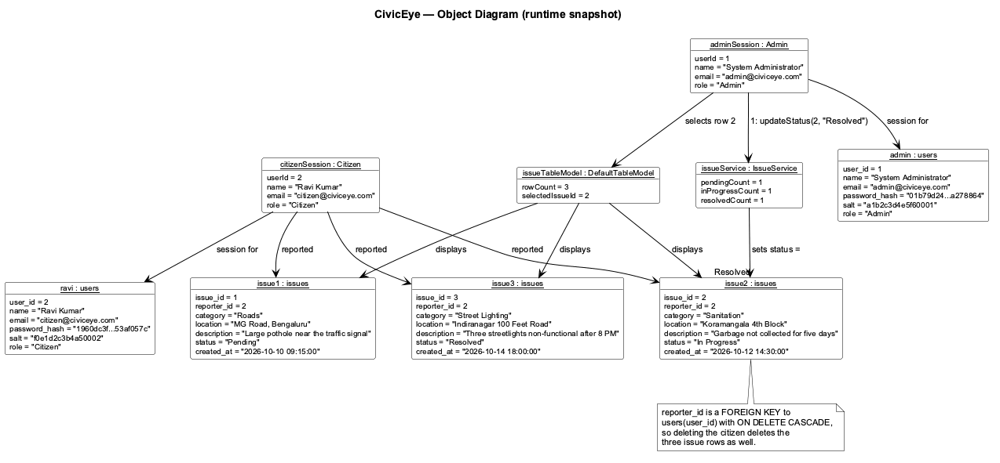

A snapshot of the system at one instant — the way a class diagram shows
*structure*, an object diagram shows *instances*.

- The two `users` rows and the three `issues` rows are exactly the rows that
  `sql/insert_sample_data.sql` puts into `civiceye_db`.
- `citizenSession : Citizen` and `adminSession : Admin` are the objects held in
  memory by the two open windows.
- `issues.reporter_id` is a foreign key to `users.user_id` with
  `ON DELETE CASCADE`, which is why every `Issue` instance is linked to its
  `Citizen`.

PlantUML source — <code>uml/03_object.puml</code>

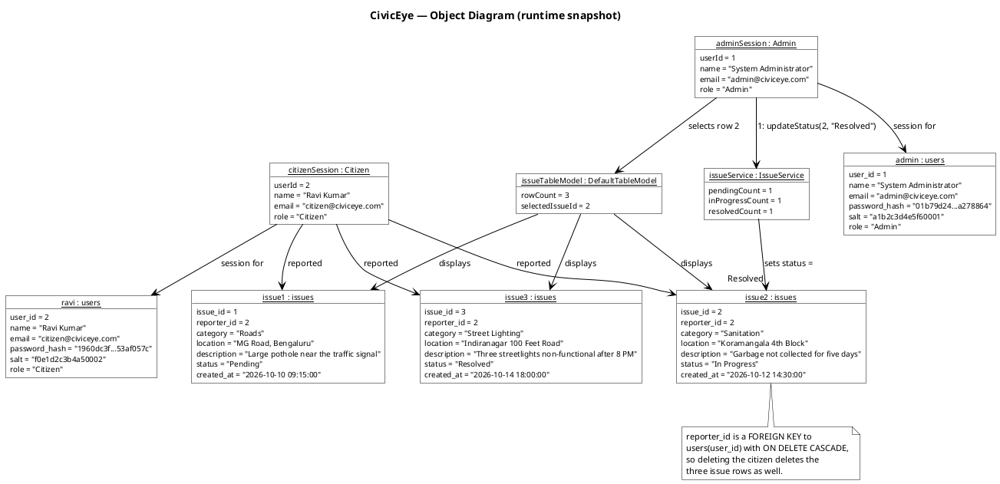

---

## 4. Sequence Diagram

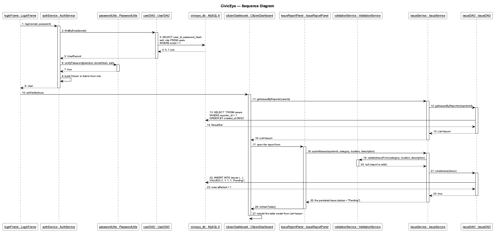

One straight scenario — the citizen logs in, the correct dashboard is opened
and an issue is reported — with no actor symbols and no combined fragments.
Vertical position is time, horizontal position is the object.

- Every participant is a **rectangle with an underlined object name**
  (`loginFrame : LoginFrame`), the StarUML way of drawing a lifeline: no stick
  figures anywhere in the diagram.
- **Login:** `loginFrame → authService → userDAO → civiceye_db`, and the stored
  SHA-256 hash is compared by `passwordUtils.verifyPassword()`.
- **Dashboard:** `loginFrame` opens the role-specific window, which asks
  `issueService` for the issues of that reporter.
- **Reporting:** `issueReportPanel` calls `issueService.submitIssue()`, which
  validates the form through `validationService` and lets `issueDAO` insert the
  row with status `Pending`.
- Solid arrows are calls, dashed open arrows are returns; the numbered sequence
  reads 1 → 27 from top to bottom.

PlantUML source — <code>uml/04_sequence.puml</code>

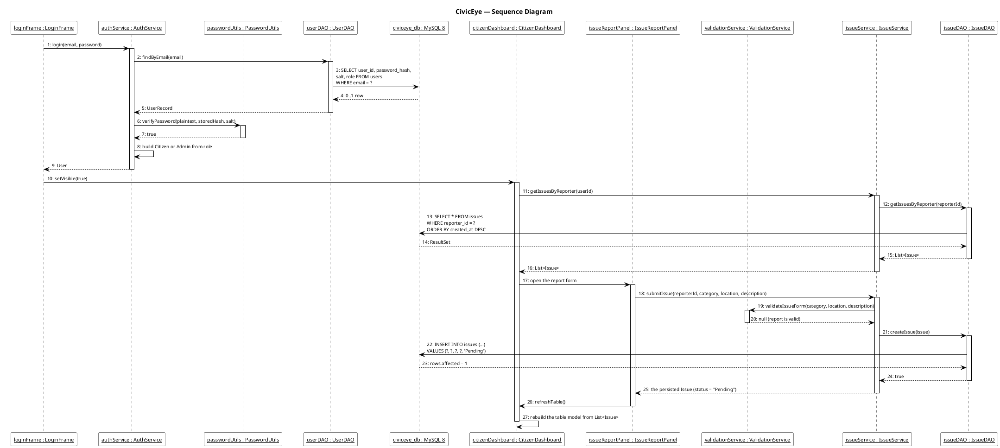

---

## 5. Collaboration Diagram

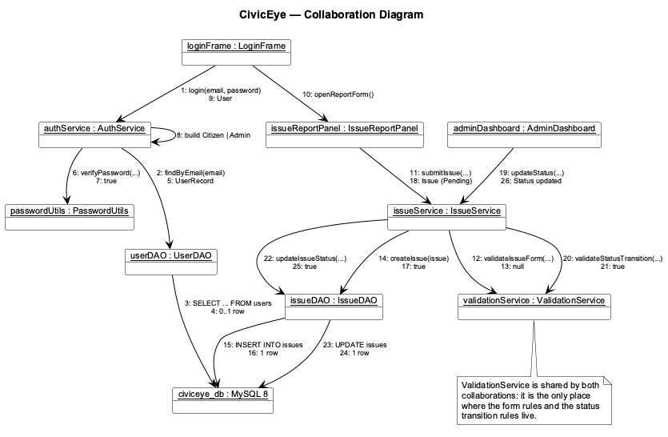

The same interaction as the sequence diagram, but drawn as the *network* of
objects instead of the time line.

- Objects are arranged in three layers — boundary objects on top, control
  objects in the middle, entity objects and the database below — so the links
  run downwards instead of across the page.
- Every link carries the call **and** its return value, numbered in the order
  in which they happen (1 → 26), exactly as a StarUML collaboration diagram
  does it.
- Messages 1‑9 are the authentication collaboration, 10‑18 the reporting
  collaboration and 19‑26 the status-update collaboration.
- `ValidationService` appears in two collaborations because it is shared by
  both flows — it is the only place where the rules live.

PlantUML source — <code>uml/05_collaboration.puml</code>

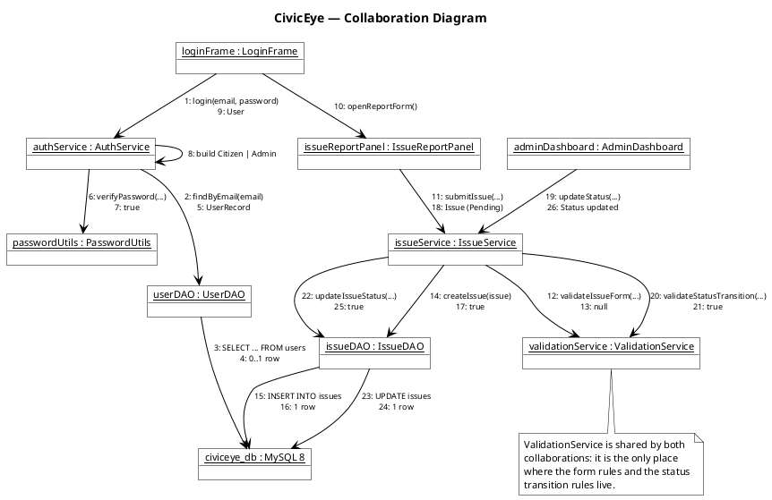

---

## 6. State Machine Diagram

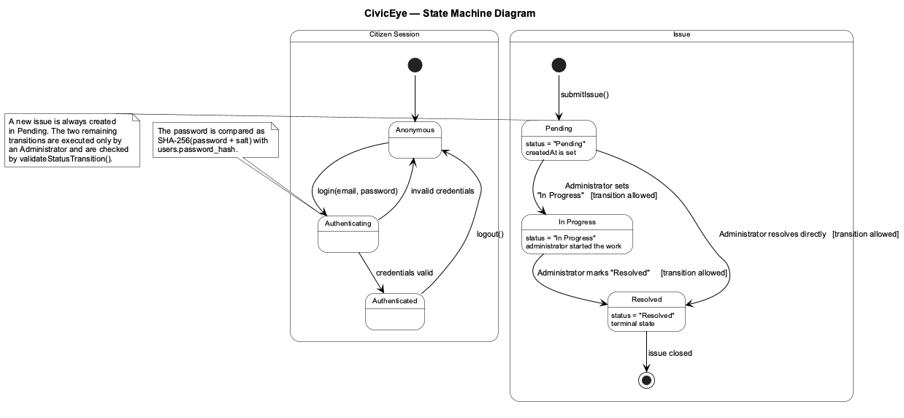

The dynamic behaviour of the two objects that have a life cycle of their own.

- **Issue:** a new report is always created as `Pending`. An administrator may
  move it to `In Progress` or straight to `Resolved`; `Resolved` is terminal.
- **Citizen Session:** `Anonymous → Authenticating → Authenticated`, with the
  failure path back to `Anonymous` and `logout()` closing the session.

PlantUML source — <code>uml/06_state_machine.puml</code>

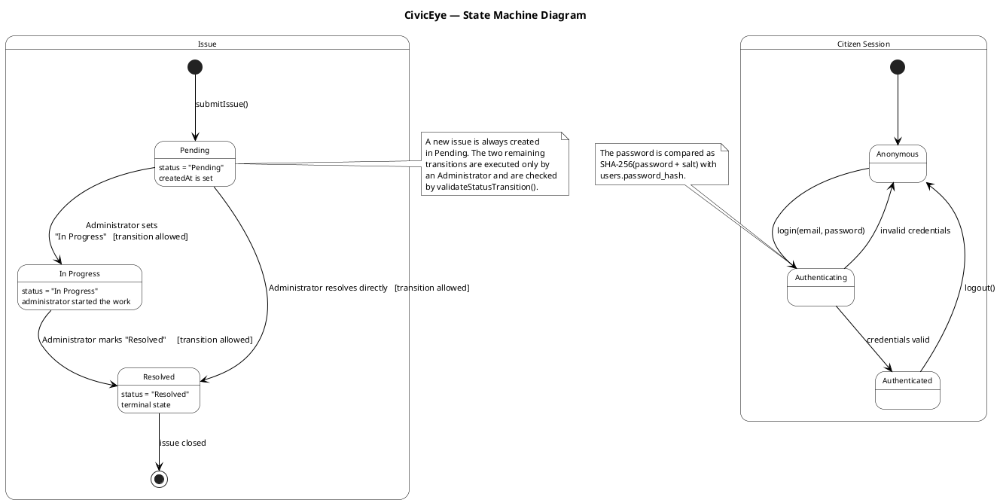

---

## 7. Activity Diagram

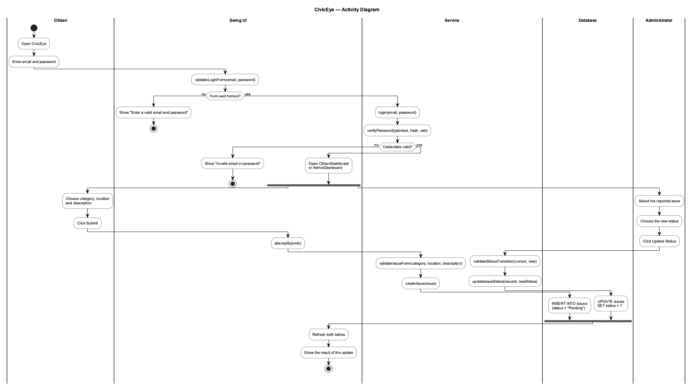

The control flow of the application across five swim-lanes.

- **Citizen** — enters the credentials, fills in the report.
- **Swing UI** — validates the input, shows the messages, refreshes the issues.
- **Service** — the business rules: login, submission, validation and the
  status transition.
- **Database** — the `SELECT`, the `INSERT` and the `UPDATE`.
- **Administrator** — reviews the report and moves the issue through
  `Pending → In Progress → Resolved`.
- **Fork / join** — once the login succeeds the token is **forked**: the Citizen
  Portal reports an issue while, concurrently, the Admin Portal updates an
  existing one. The thick black fork bar splits the flow, the matching join bar
  merges the two branches again before `start` reaches its final state.
- The diamonds are the two decisions the application really makes: is the input
  well formed, and are the credentials valid.

PlantUML source — <code>uml/07_activity.puml</code>

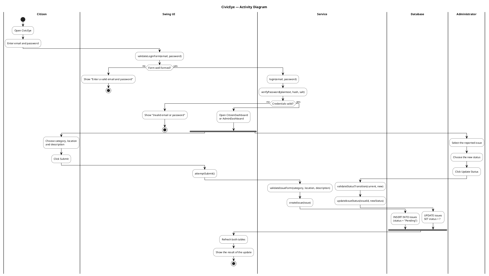

---

## 8. Component Diagram

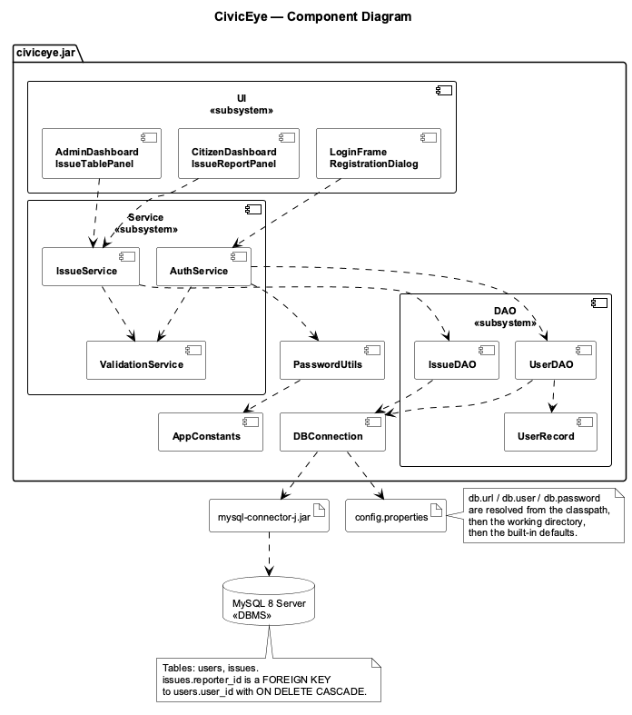

How the code is packaged and what it depends on.

- `civiceye.jar` is the single package; the dashed arrows are unlabelled UML
  dependencies, always pointing from the caller to the callee.
- The UI depends on the services, the services depend on the DAOs, and the
  DAOs depend on `DBConnection` and on the MySQL connector JAR.
- `config.properties` is read by `DBConnection`; it holds `db.url`,
  `db.user` and `db.password`.
- The MySQL server is an external `«DBMS»` node — it is not part of the build.

PlantUML source — <code>uml/08_component.puml</code>

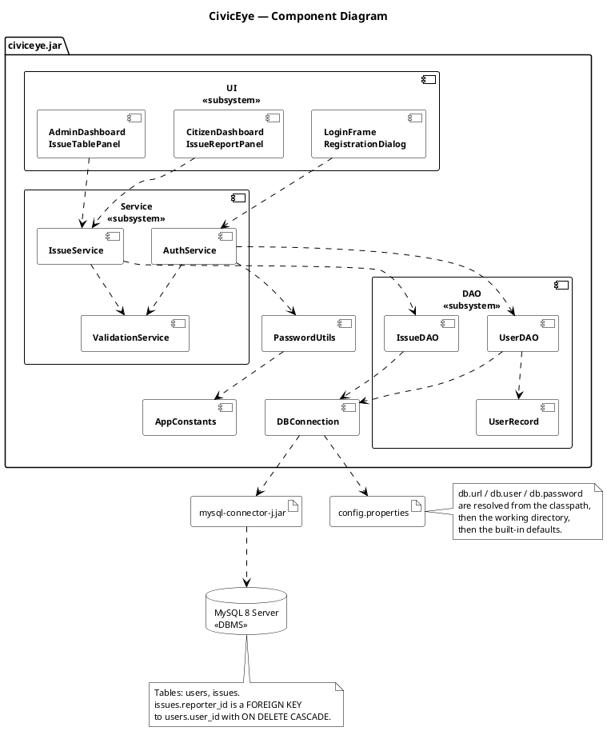

---

## 9. Deployment Diagram

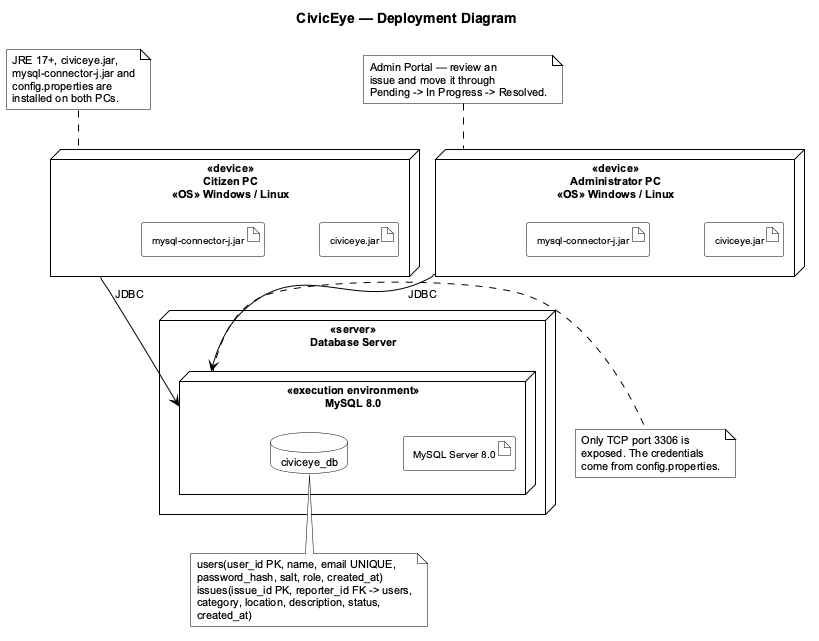

The runtime topology of the installation.

- The application is a desktop client: two `«device»` nodes (Citizen PC and
  Administrator PC) hold the deployed `civiceye.jar` and
  `mysql-connector-j.jar`; the JRE 17+ and `config.properties` are noted on the
  node itself.
- Both workstations talk to the `«server»` node over JDBC/TCP 3306.
- Inside the server, the `«execution environment»` *MySQL 8.0* hosts the
  *MySQL Server 8.0* artifact and the `civiceye_db` database.

PlantUML source — <code>uml/09_deployment.puml</code>

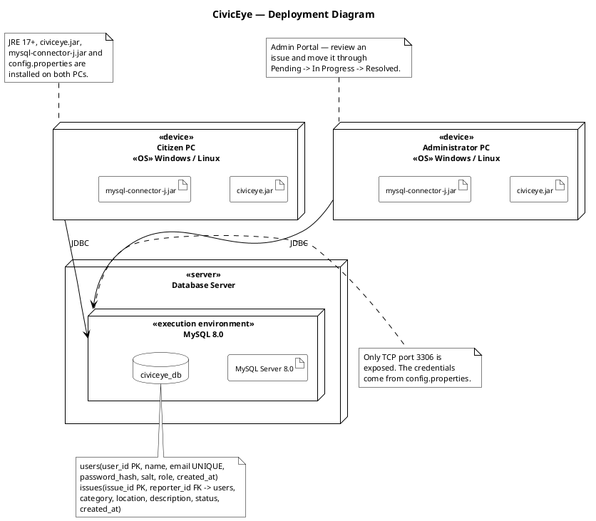

---

## Figure index

| # | Diagram | PNG | SVG | Source |
|---|---|---|---|---|
| 1 | Use Case Diagram | [png](uml/01_use_case.png) | [svg](uml/01_use_case.svg) | [puml](uml/01_use_case.puml) |
| 2 | Class Diagram | [png](uml/02_class.png) | [svg](uml/02_class.svg) | [puml](uml/02_class.puml) |
| 3 | Object Diagram | [png](uml/03_object.png) | [svg](uml/03_object.svg) | [puml](uml/03_object.puml) |
| 4 | Sequence Diagram | [png](uml/04_sequence.png) | [svg](uml/04_sequence.svg) | [puml](uml/04_sequence.puml) |
| 5 | Collaboration Diagram | [png](uml/05_collaboration.png) | [svg](uml/05_collaboration.svg) | [puml](uml/05_collaboration.puml) |
| 6 | State Machine Diagram | [png](uml/06_state_machine.png) | [svg](uml/06_state_machine.svg) | [puml](uml/06_state_machine.puml) |
| 7 | Activity Diagram | [png](uml/07_activity.png) | [svg](uml/07_activity.svg) | [puml](uml/07_activity.puml) |
| 8 | Component Diagram | [png](uml/08_component.png) | [svg](uml/08_component.svg) | [puml](uml/08_component.puml) |
| 9 | Deployment Diagram | [png](uml/09_deployment.png) | [svg](uml/09_deployment.svg) | [puml](uml/09_deployment.puml) |
